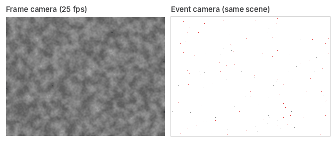
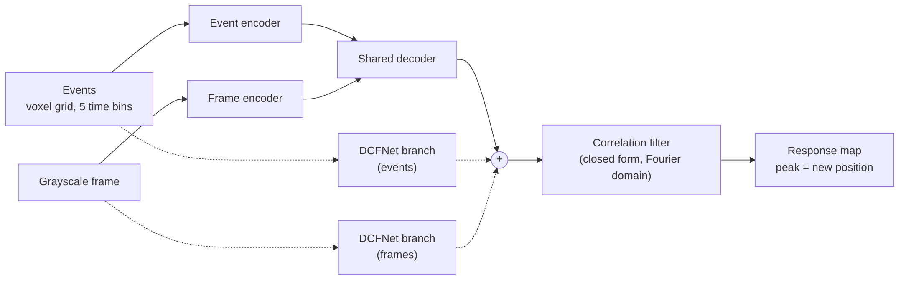
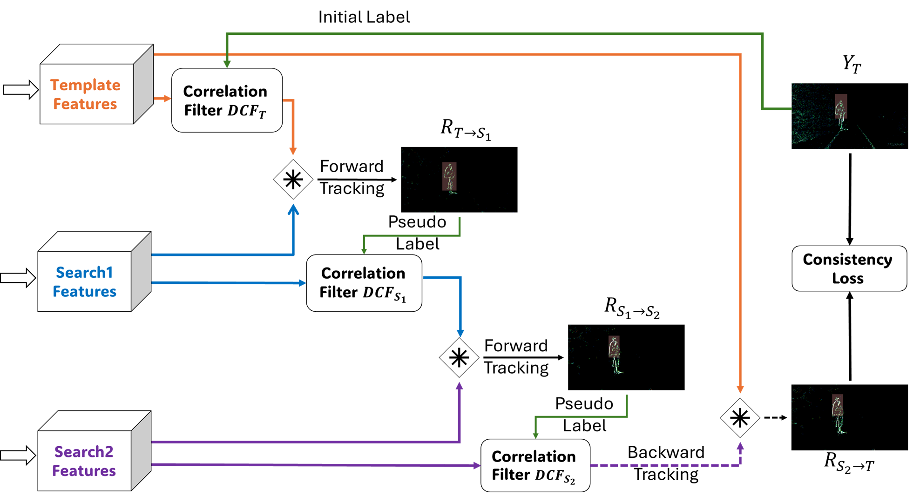

This is a walkthrough of ED-DCFNet, the paper from my research at the NBEL lab with Hadar Cohen-Duwek and Elishai Ezra Tsur, published at the CVPR 2024 Workshops. The code and our dataset are on GitHub: [NBELab/UnsupervisedTracking](https://github.com/NBELab/UnsupervisedTracking).

## Event cameras in one paragraph

A normal camera takes full frames at a fixed rate. An event camera doesn't take frames at all. Each pixel reports on its own, whenever its brightness changes, as an event with a position, a timestamp and a polarity (brighter or darker). That gives very high temporal resolution, high dynamic range, almost no motion blur and very low power, which makes event cameras attractive for tracking on small embedded devices. The catch: a static scene produces no events, texture is hard to see, and the data looks nothing like the images most vision models are trained on.



*A simulation of the same scene seen by both cameras. The frame camera repeats the static background in every frame and blurs the fast ball. The event camera stays silent wherever nothing changes and reports only the moving edges: blue where a pixel got brighter, red where it got darker.*

## The problem we went after

The strongest trackers that combine events and frames are large transformer or CNN models trained with supervision. That fits event cameras badly twice over: annotated event data is scarce and expensive, and a large model throws away the low-power advantage. We wanted the opposite: a small network, trained without any labels, that can track on events alone, frames alone, or both.

## Correlation-filter tracking

The tracker is a discriminative correlation filter (DCF). From the features of the target in the first frame (the template), you solve for a filter that, correlated with those features, produces a sharp Gaussian peak at the target's center. In the Fourier domain this has a closed-form solution, so computing and applying the filter costs a few FFTs. On the next input you correlate the filter with the new features, and the peak of the response map is where the object moved. Then you update the filter and repeat.

DCFNet's idea was to learn the features end to end through this closed-form filter. ED-DCFNet keeps that tracker and changes what feeds it.

## The model



*The architecture, from the [project repo](https://github.com/NBELab/UnsupervisedTracking).*

- **Events become a voxel grid.** The time window is split into 5 bins, and each event's polarity is spread into the neighbouring bins according to its timestamp. That keeps the order of events inside the window while giving a dense tensor a CNN can read.
- **Two encoders, one shared decoder.** An event encoder (5 input channels) and a frame encoder (1 grayscale channel) map each input into features, and a decoder shared by both maps them into the same feature space. The shared decoder is what pushes events and frames toward features that mean the same thing.
- **DCFNet branches as skip connections.** Each input also goes through a small DCFNet branch (two 3×3 convolutions) that keeps modality-specific detail. A modality's feature is its decoder output plus its branch, and the hybrid feature is the sum of the event and frame features.

The whole hybrid model has 71,424 parameters.

## Training without labels

There are no bounding boxes anywhere in training. It uses forward-backward consistency: take a template and two later inputs, track forward from the template to the first and from the first to the second, then track backward from the second to the template's frame. If the features are good, the backward response lands back on the template's center as a sharp peak. The loss is the distance between that backward response and a Gaussian at the center. For the hybrid model it is a weighted sum over the fused, frame-only and event-only features (0.5, 0.3 and 0.2).



*Forward-backward training, from the [project repo](https://github.com/NBELab/UnsupervisedTracking).*

The training data is synthetic. We used the ESIM simulator to generate events and grayscale frames from 111 ten-second videos of COCO objects moving with affine motions (translation, rotation, scaling) at different speeds. Four sequence augmentations add variety to the motion: reversing the sequence, inverting the polarity of every event, shuffling the search inputs, and a "fastback" that replaces the last input with the template to create a sudden return.

## A new dataset

We also recorded and annotated 19 indoor sequences with a DAVIS346, a camera that outputs events and frames from the same sensor. They cover a moving object with a static camera and a moving camera with a static object, in daylight and low light, with fast motion, motion blur, over- and under-exposure, reflective surfaces and transparent objects. The dataset is open and linked from the repo.

## Results

We evaluated on OTB2015 converted to events with ESIM, and on our indoor dataset. The success score is the average overlap between the predicted and true boxes.

| Model | OTB2015 success | Indoor success | Parameters | Latency |
|---|---|---|---|---|
| DCFNet, events | 0.273 | 0.579 | 10,144 | 6.3 ms |
| ED-DCFNet, events | 0.299 | 0.600 | 43,040 | 6.5 ms |
| DCFNet, frames | 0.458 | 0.784 | 9,568 | 3.8 ms |
| ED-DCFNet, events + frames | 0.463 | 0.785 | 71,424 | 10.3 ms |

The clearest gain is on events alone, where the learned features beat DCFNet on both benchmarks. Combining events and frames edges out frames alone, though on the indoor dataset only barely: the frame features tend to dominate the fusion. Per sequence, the best input depends on the scene. On the sequence with a transparent object, events alone did best, because the frames struggle with reflections.

## What I took from it

- **Small and unsupervised goes a long way.** A 71k-parameter model trained only on synthetic data, without a single label, tracks on real event-camera recordings.
- **Self-consistency is a strong training signal for tracking.** If you can track there and back, your features are good.
- **Fusion is harder than it looks.** A second modality only helps where the first one fails, so the interesting cases are the hard ones: low light, blur, glare and transparent objects.

## Links

- Paper: [CVPR 2024 Workshops, open access](https://openaccess.thecvf.com/content/CVPR2024W/EVW/html/Ramon_ED-DCFNet_An_Unsupervised_Encoder-decoder_Neural_Model_for_Event-driven_Feature_Extraction_CVPRW_2024_paper.html)
- Code and dataset: [github.com/NBELab/UnsupervisedTracking](https://github.com/NBELab/UnsupervisedTracking)
- The earlier, event-only version: *Object Tracking within Event Streams using Unsupervised Discriminative Correlation Event Filter*, ICCI\*CC 2023 (Best Paper Award).

```bibtex
@InProceedings{Ramon_2024_CVPR,
    author    = {Ramon, Raz and Cohen-Duwek, Hadar and Tsur, Elishai Ezra},
    title     = {ED-DCFNet: An Unsupervised Encoder-decoder Neural Model for Event-driven Feature Extraction and Object Tracking},
    booktitle = {Proceedings of the IEEE/CVF Conference on Computer Vision and Pattern Recognition (CVPR) Workshops},
    month     = {June},
    year      = {2024},
    pages     = {2191-2199}
}
```
