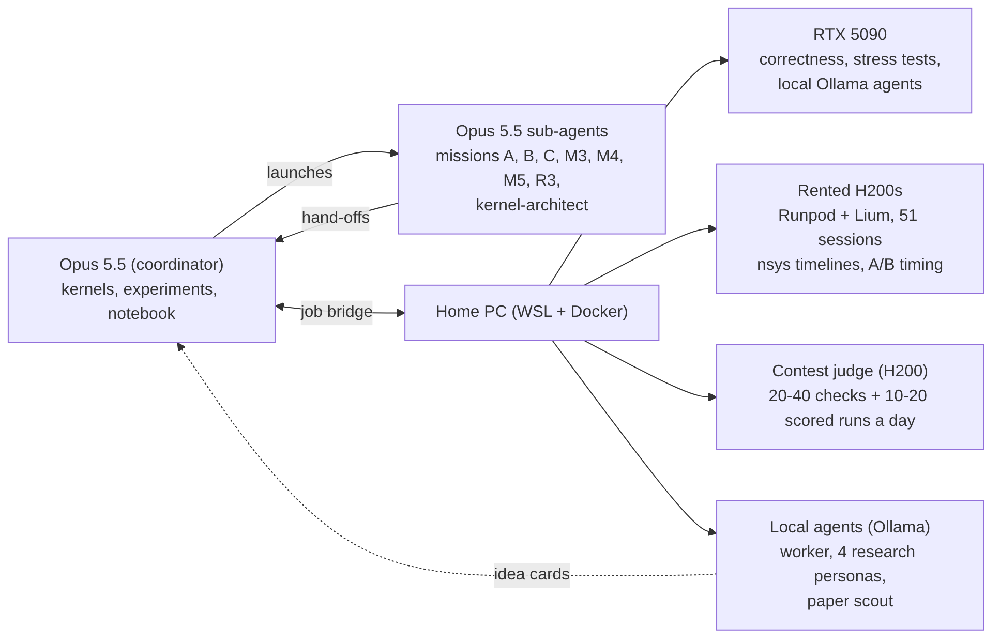
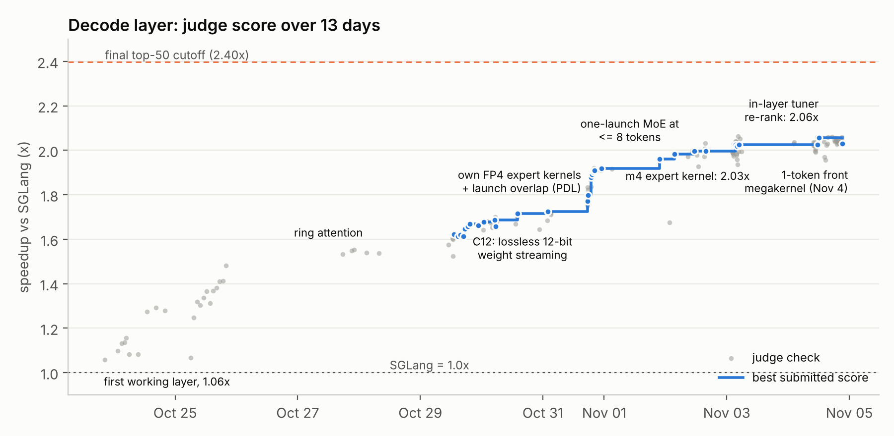
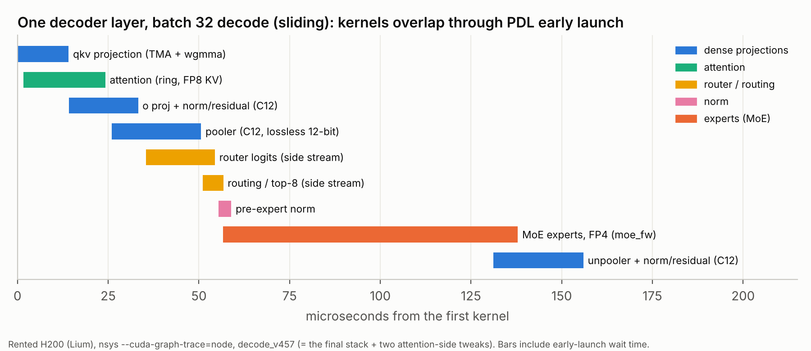
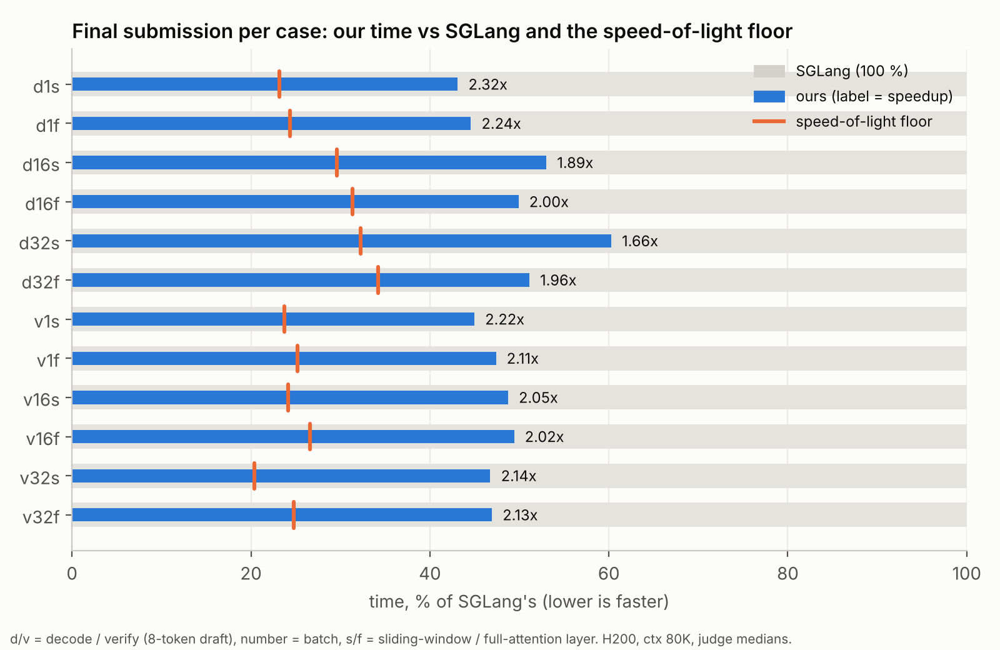

For two weeks in October and November I took part in the [Muse Spark Open Kernel Challenge](https://openkernelchallenge.dev). The task: take one complete decoder layer of a mixture-of-experts LLM (attention, router, NVFP4 experts, every norm and residual) and make it run faster than SGLang's implementation on an NVIDIA H200. More than 2,000 teams entered.

Our final submission runs **2.06x faster than SGLang** overall, and 2.32x on single-request decode. That put us at rank 516 of 1,299 on the decode-layer board, inside the top 40 %. The winner reached 2.61x.

I didn't write the CUDA by hand. I came in to learn GPU kernel optimization, not as a CUDA engineer, so I ran the challenge as an experiment with a second question: how far can one person get by setting up and steering AI agents? This post is about that setup, what moved the number, what didn't, and what the hardware taught us. Everything, the failures included, is in the [repo](https://github.com/razramon/openkernelchallenge-submission).

## The setup

- **One long Claude Opus 5.5 session was the coordinator.** It wrote the kernels, planned the experiments, ran the judge checks and kept a lab notebook. The notebook ended up being the most important file in the project: the session's context reset many times, and every fresh context started by re-reading it.
- **Sub-agents took the independent tracks.** When the work split (expert kernels, full attention, verify attention), the coordinator launched sub-agents, each with its own version numbers and job ids so they never collided, and they handed their results back.
- **A job bridge connected it all to my PC** (WSL + Docker). Through it the coordinator reached the RTX 5090 (correctness tests, plus local Ollama agents that proposed ideas), the rented H200s (timing) and the contest judge.

My part was setting this up and steering it: which ideas to chase, when to gamble on a big rewrite, and approving every rented GPU hour. In total that was 51 pod sessions, at least 66 GPU-hours and $290.

## Why a decode layer is a memory problem

At decode batch sizes a layer does almost no math. At 1–32 tokens it reads 140–200 MB of dense weights plus about 28 MB per active expert, and touches each byte once. The H200's memory moves 4.8 TB/s at peak and about 4.3 TB/s in practice, so the floor for single-request decode is about 40 µs. SGLang takes 172 µs; we finished at 74 µs.

So nearly every win was one of three things: read fewer bytes, start reading them sooner, or remove a gap between kernels.

## What moved the number

**Lossless 12-bit weights.** A BF16 weight is 1 sign, 8 exponent and 7 mantissa bits, but the weights of one trained layer sit in a narrow range of exponents. Our format, C12, keeps the sign, a 4-bit exponent offset and the 7-bit mantissa: 12 bits instead of 16. The rare values outside the window (about 1 in 10,000–25,000) are stored exactly on the side and patched back in. That is 25 % fewer bytes for every projection, with bit-exact results. One bitwise instruction turns two 12-bit codes into two valid BF16 numbers, so the weights go from memory straight into the tensor cores.

**Kernels that overlap instead of queueing.** With programmatic dependent launch, the next kernel can start while the previous one is still running. Each of our kernels issues its weight loads first and only then waits for the previous kernel's output, so its weight stream starts during its predecessor's tail. Our first version ran about 20 kernels per layer; the final one runs 6 to 10.

**One launch for the whole MoE at small batch.** At 1 token, a single persistent kernel does the router, the top-8 routing, the pooler, the pre-expert norm and every routed expert. The expert weights start streaming as soon as routing finishes, while the pooler is still running.

**A kernel per regime, tuned in place.** 1 token, 2–16, 17–32 and 128–256 tokens each get their own MoE and attention kernels, tuned on the judge's own GPU during the allowed prepare time. The last step on the chart came from re-timing the tuner's best candidates inside the full layer instead of in isolation.

## What didn't

**The megakernel, twice.** The obvious idea is to fuse the whole front of the layer (qkv projection, attention, output projection) into one persistent kernel. The first attempt lost 9–14 %: inside one kernel, every stage waited on hand-offs between thread blocks while memory sat idle. On the last day we built a leaner version. Measured alone, it was 9 µs faster than the production path. Inside the layer, it saved at most 1.6 µs, because the chain of overlapping kernels was already hiding the front behind the weight streams of the kernels after it.

**Prefetching into L2.** Several attempts to pull the next kernel's weights into the 50 MB L2 early never paid off. The memory bus was never idle long enough for a prefetch to be free.

**Work stealing in the expert kernel.** Letting idle thread blocks take units from the busiest expert was correct on every test, but 0–6 % slower per job at the judge's load.

## What the hardware taught us

**The 5090 is a correctness lab, not a stopwatch.** It's a different architecture (no wgmma, no TMA multicast, 99 KB of shared memory per block instead of 227 KB), and its 96 MB L2 keeps test weights cached, so memory-bound kernels look compute-bound. It caught races, deadlocks and wrong answers for free, thousands of times. Its timings never picked a winner.

**Rented H200s are not all the same H200.** One pod had a 630 W power cap, and the expert kernel's clock fell from 1.74 to 0.58 GHz halfway through. Some nodes were the 600 W NVL variant, some had profiler counters disabled, some couldn't restart after being stopped, and one image pull took 27 minutes. After that, every pod timing came with its clock and power reasons.

**Our test workload was wrong for days.** Our harness routed tokens to a lighter set of experts than the judge did: at batch 1, about 1 active expert instead of 2.5. That hid a 10 µs gap, and every pod comparison of an MoE change was measured at the wrong load. The fix was two lines.

**The judge is noisy and rationed.** About ±1 % per run overall and ±2–5 % per case, with 20 checks a day (40 on the last days). One check can't confirm a 0.5 % idea, and submitting the best of several checks selects luck: our submissions landed 1–2 % below the check that picked them.

## What I'm taking away

- **Read the scoring formula before optimizing.** Here, 1 µs saved on single-request sliding decode was worth as much as 15 µs on batch-32 full verify.
- **Make the test workload identical to the scored one** before trusting any measurement.
- **Measure in the whole system.** When kernels overlap, a faster kernel in isolation can be no faster in place.
- **Write everything down.** For the agents, the notebook was the only memory that survived, and most good ideas came from re-reading it.

On working this way: the agents wrote almost all of the code, and fast. The slow part was never typing code. It was knowing which measurement to trust and which idea was dead, and the lab notebook is what kept the work from going in circles.

The kernels, the tools, the full notebook and every failed idea are in the repo: [github.com/razramon/openkernelchallenge-submission](https://github.com/razramon/openkernelchallenge-submission).
